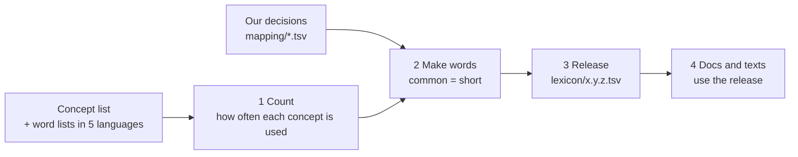

<!-- Generated by docs/build_docs.py from docs/src/A-pipeline.md and lexicon/0.1.1.tsv. Edit the source, not this file. -->
# A. How a new lexicon is published

The current version is **0.1.1**. All versions: [lexicon/CHANGELOG.md](../lexicon/CHANGELOG.md).

## The idea / 概念

We never invent words by hand. We decide *which concepts* the language has; a program then counts how often each concept is used in five languages and gives the most common ones the shortest words. Every published list of words is a numbered **version**, saved in `lexicon/` and never changed afterwards.



## Steps / 步驟

Run these from the project folder. Setup is in the [main README](../README.md).

**1. Count how often each concept is used.**

```bash
.venv/Scripts/python -X utf8 pipeline/build_concept_freq.py
```

Only needed when the concepts or the data change. Our own concepts, merged pronouns and compounds are listed in `mapping/`; edit those files to change what the language has.

**2. Make the words.**

```bash
.venv/Scripts/python -X utf8 pipeline/build_lexicon.py
```

This writes a *draft* word list to `out/lexicon.tsv`. Nothing is published yet, so you can try changes and run it again as often as you like. To see a text in the draft:

```bash
.venv/Scripts/python -X utf8 pipeline/render.py texts/udhr-article-1.txt
```

**3. Check.**

```bash
.venv/Scripts/python -m pytest
```

All tests must pass. Also read a few words and texts: do they look right?

**4. Release.** Pick the next version number (see below) and say in one line what changed:

```bash
.venv/Scripts/python -X utf8 pipeline/release.py 0.2.0 --note "added 40 everyday concepts"
```

This freezes the draft as `lexicon/0.2.0.tsv` and adds an entry to the changelog. It refuses to overwrite a version that already exists.

**5. Update the docs.**

```bash
.venv/Scripts/python -X utf8 docs/build_docs.py
```

All words in these pages are taken from the newest version.

**6. Commit** `lexicon/`, `docs/` and whatever you changed in `mapping/` or `texts/`, together.

## Which version number? / 版本號

Versions look like `MAJOR.MINOR.PATCH`, e.g. `0.2.0`.

| Situation | Next number | Example |
| --- | --- | --- |
| Beta (before 1.0.0): words change | raise the middle number | 0.1.0 → 0.2.0 |
| Beta: no word changes (IPA, glosses, notes) | raise the last number | 0.1.0 → 0.1.1 |
| Words are final | 1.0.0 | |
| After 1.0.0: new words only | raise the middle number | 1.0.0 → 1.1.0 |
| After 1.0.0: fix a typo in a gloss or note, no word changes | raise the last number | 1.1.0 → 1.1.1 |
| After 1.0.0: an existing word must change | raise the first number | 1.4.0 → 2.0.0 |

In a beta, words can still change from one version to the next. From 1.0.0 on, a word that has been published keeps its meaning forever.

## Rules after 1.0.0 / 1.0.0 之後的規則

- **Old words never change.** New words go into free spaces that were kept empty on purpose (10% of the two-syllable words), so no old word has to move.
- **Every word can still be told apart.** No word is the beginning of another word, and filling an empty space never changes that.
- **A removed word's form is never given to another concept**, so old texts are never read with a new meaning.

## What a version contains / 版本裡有什麼

| File | Contents |
| --- | --- |
| `lexicon/x.y.z.tsv` | Every concept: its word, syllables, spelling with empty consonants (`cvc`), IPA, and `rank` (1 = most frequent word) |
| `lexicon/x.y.z.json` | Numbers: how many words of each length, average length, free spaces left |
| `lexicon/CHANGELOG.md` | One entry per version: what changed |

The frequencies behind the ranks are not published, because the data they come from does not allow it (see [ATTRIBUTION.md](../ATTRIBUTION.md)).

## Writing texts and editing these pages / 寫文章與編輯頁面

- **Texts** (`texts/*.txt`) are written with concept names, one sentence per line, `_` for spaces: `PERSON ALL BE_BORN FREE`. They turn into words of whatever version is current, so they never go out of date.
- **These pages** are made from `docs/src/*.md`. Edit there, then run step 5. A placeholder such as `{{w: I SEE DOG}}` is replaced by the words of the current version. Examples about sound or spelling instead fix the word and look up its meaning, `*hitet* "{{en: hitet}}"`, so they stay true when the words change; the build fails if such a word no longer exists. Pronunciations are written as `{{say: hitet mö = çi.tɛp mø}}`: the build checks them against the sound rules in `pipeline/phonetics.py`, and the tests check that the examples use every rule and that the latest lexicon matches the rules (if not, release a new version). The tests fail if the pages are out of date.
